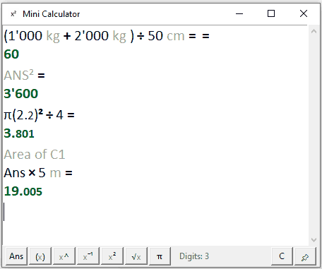
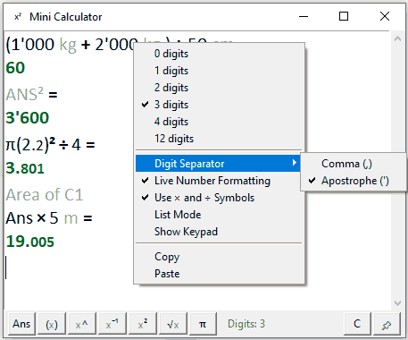
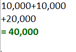

# Mini Calculator

A Windows calculator built for working notes, not just button pressing: write calculations, units, and descriptions together, keep the complete line for a report, and still get the numerical result.

Designed as a calculation scratchpad: keep expressions, units, notes, and results together in an editable workspace.

Created by Amirhossein with iterative development assistance from ChatGPT.

## Screenshots

### Main window
Shows mixed calculations, units, notes, `Ans`, powers, pi, and formatted results in one editable workspace.



### Right-click options
Precision, digit separator, live formatting, mathematical symbols, List Mode, and keypad visibility are all available from the context menu.



### Implicit multiplication & parenthesis auto-completion
Adjacent parenthesized expressions are interpreted as multiplication, and unfinished parentheses are completed automatically when the expression is evaluated.


### List Mode
Enter one value or operation per line and keep a continuously updated result for quick running calculations.



## Highlights

- Normal calculation history that remains editable.
- **List Mode** for one value or operation per line, with a continuously updated result.
- Units and nearby descriptive text can remain in the note while the mathematical parts are calculated.
- Automatic thousands separators using either commas or apostrophes.
- Optional live number formatting and optional `×` / `÷` display symbols.
- Smaller fractional digits, bold operators, and formatted result lines.
- Parenthesis completion, implicit multiplication, powers, square roots, pi, and `Ans`.
- Selection-aware `(x)`, `x^`, `x⁻¹`, `x²`, and `√x` buttons.
- Optional numeric keypad, always-on-top control, system-tray support, and Ctrl+mouse-wheel font sizing.
- Copy and paste shortcuts continue to work with a Persian keyboard layout.
- Settings and history are stored locally; the calculator makes no network requests.

## Download for Windows

Open the repository's **Releases** page and choose one of these files:

- `MiniCalculator.exe` — one portable file.
- `MiniCalculator-Fast.zip` — extract the folder and run `MiniCalculator-Fast.exe`; this version starts faster.

Windows may display a SmartScreen warning because community builds are not code-signed. Use the source build if you prefer to inspect everything before running it.

## Quick use

Type an expression and press **Enter**:

```text
2,500 + 3,500 kg
= 6,000
```

The text remains available for copying into a report. Right-click the calculator—or click the `Digits:` status—to change precision, the digit separator, live formatting, mathematical operator symbols, List Mode, or keypad visibility.

In List Mode, operators begin the following operation line:

```text
10,000
+20,000
×2
= 60,000
```

Pressing an operator as the first entry of a new List Mode series automatically starts from the previous series result.

## Run from source

1. Install Python 3.10 or newer for Windows with Tcl/Tk support.
2. Install the optional tray dependencies:

   ```powershell
   py -m pip install -r requirements.txt
   ```

3. Double-click `mini_calculator.pyw`, or run:

   ```powershell
   py mini_calculator.pyw
   ```

The calculator still runs if the optional tray packages or icon cannot be loaded.

On the first launch, Mini Calculator opens with a short example that demonstrates units, apostrophe digit grouping, mathematical operator symbols, and a formatted answer. After the program closes, each user's own local state replaces this starter example.

## Build the Windows packages

On Windows, double-click `build_windows.bat`. The two distributable files will be placed in the `release` folder. GitHub Actions also builds them automatically on every push. This revision publishes the public `v1.0.1` release; later version tags create their corresponding releases.

## Privacy

The release package does not contain the creator's calculation history or preferences. Each user's history and settings are saved locally in `calculator_state.txt`. See [PRIVACY.md](PRIVACY.md) for details.

## License

Mini Calculator is released under the [MIT License](LICENSE), so anyone may use, study, modify, and share it.
